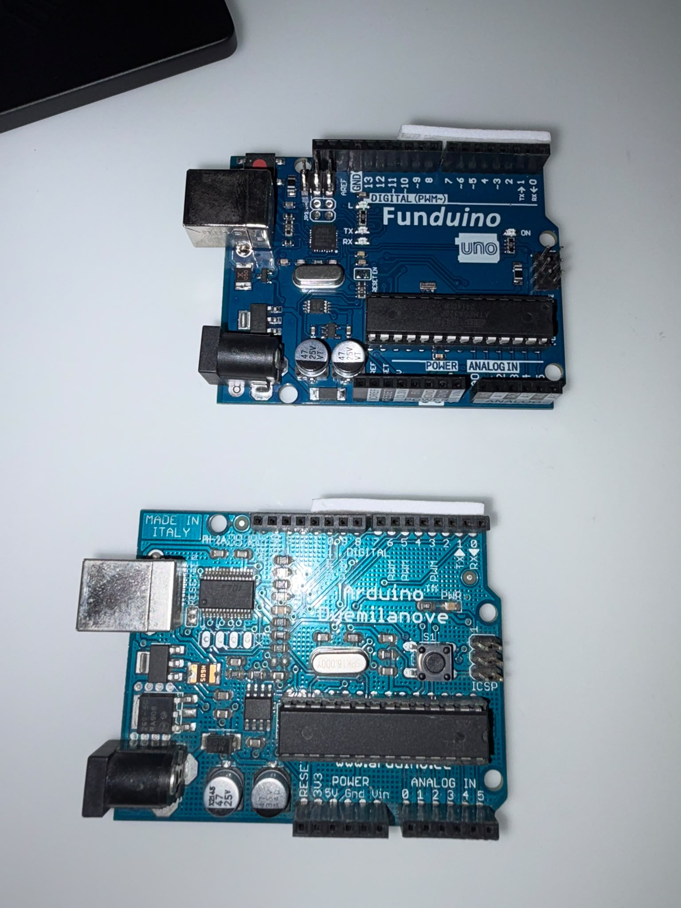
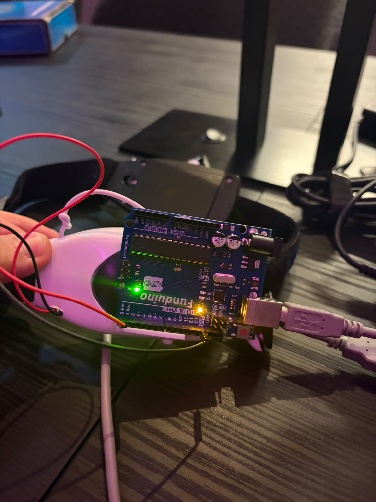
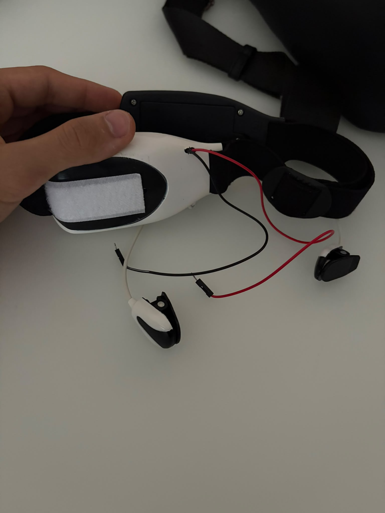

# MindFlex BCI - EEG-gesteuertes RC-Auto

Ein Brain-Computer-Interface-Projekt: Ein gehacktes MindFlex-EEG-Headset (ThinkGear-Chip)
liefert über einen Arduino Rohdaten, die in Echtzeit visualisiert, aufgezeichnet, als
Trainingsdaten für mehrere Machine-Learning-Modelle genutzt und schliesslich in
Fahrbefehle für ein zweites, per Arduino gesteuertes RC-Auto umgesetzt werden.

## Screenshots

Live-Vorhersage inklusive EEG-Graph, Richtungsanzeige und Modell-Genauigkeit:

| FORWARD | STOP |
|---|---|
|  |  |

## Projektstruktur

```
BrainGrapher/     Processing-Sketch zur Live-Visualisierung der rohen EEG-Signale
                  (Signalqualitaet, Attention, Meditation, Delta/Theta/Alpha/Beta/Gamma)
MindFlex_BCI/     Python-Anwendung: Feature-Extraktion, Modelltraining (Decision Tree,
                  Random Forest, KNN), Echtzeit-Klassifikation und RC-Auto-Steuerung
                  ueber eine PyQt5/pyqtgraph-Oberflaeche
```

## Herkunft und eigener Anteil

`BrainGrapher/` basiert auf dem quelloffenen
[Processing-Brain-Grapher](https://github.com/kitschpatrol/Processing-Brain-Grapher) von
Eric Mika (MIT-Lizenz, siehe `BrainGrapher/LICENSE.txt`). Dieser Teil diente als
Ausgangspunkt, um die rohen Sensordaten des gehackten MindFlex-Headsets überhaupt
zuverlässig vom Arduino zu empfangen und zu visualisieren (inkl. Debugging der seriellen
Verbindung/COM-Port-Erkennung).

`MindFlex_BCI/` ist eine vollstaendig eigene Neuentwicklung: die komplette
Datenverarbeitungs-Pipeline (Validierung, Ringpuffer, Feature-Extraktion), das
Trainings-/Klassifikations-System (mehrere ML-Modelle inkl. automatischer Auswahl des
besten Modells), die Echtzeit-Vorhersage mit visueller Richtungsanzeige sowie die
Ansteuerung des RC-Autos über eine zweite serielle Verbindung.

## Hardware-Aufbau

1. **EEG-Arduino**: MindFlex-Headset (ThinkGear) -> Arduino mit
   [Arduino Brain Library](https://github.com/kitschpatrol/Brain) -> USB/seriell an den PC
   (CSV-Format: SignalQuality, Attention, Meditation, Delta, Theta, LowAlpha, HighAlpha,
   LowBeta, HighBeta, LowGamma, HighGamma).
2. **RC-Auto-Arduino**: empfängt Einzelzeichen-Befehle (`F`/`B`/`L`/`R`/`S`) über eine
   zweite serielle Verbindung und setzt sie in Motoransteuerung um.

| Arduino-Boards | Arduino am Headset montiert | Elektroden-Nahaufnahme |
|---|---|---|
|  |  |  |

## Schnellstart

Siehe [`MindFlex_BCI/README.md`](MindFlex_BCI/README.md) für die vollständige
Setup-Anleitung (Python-Installation, Abhaengigkeiten, Start, Training).

Fuer die reine Signal-Visualisierung ohne ML-Pipeline: `BrainGrapher/BrainGrapher.pde`
in der [Processing IDE](https://processing.org/download) oeffnen.

## Ablauf


## Lizenz

- `BrainGrapher/`: MIT, Copyright (c) 2010-2025 Eric Mika (siehe `BrainGrapher/LICENSE.txt`)
- `MindFlex_BCI/`: MIT, siehe `LICENSE` im Hauptverzeichnis
